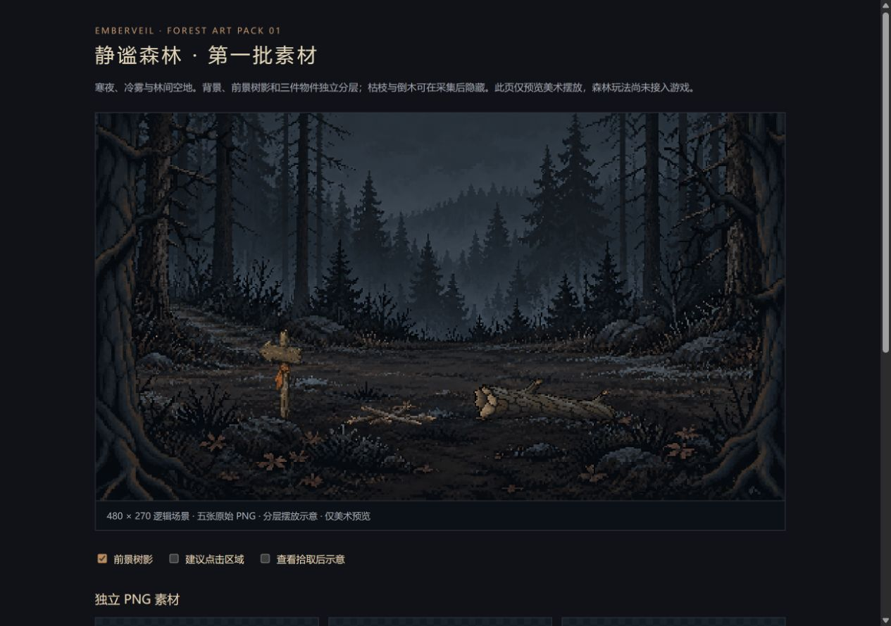

# 静谧森林 · 素材交付

日期：2026-10-15。后续工程与美术均由 Codex 接手。首批美术已接入近林拾柴原型，可在游戏内点门出发；详见 [第二阶段工程说明](../../engineering/phase2-forest.md)。下面保留首批美术交付记录。

## 画面方向

延续黑屋的冷灰与旧木材，室外更冷，远处树木融入雾中；近景树影框住空地。中央的枯枝与右侧倒木是可采集物，左侧带布条的路标指向回屋。物件与背景分开，避免采集后背景中仍残留同一件木头。

## 交付

- `assets/pixel/forest/v1/`：五张原始 PNG、透明通道与尺寸信息、裁取清单、接入说明。
- `asset-preview.html`：实际素材组合，沿用现有像素缩小算法；可开关前景、查看建议热区和拾取后示意。
- `PROMPTS.md`：全部实际生成提示词。工具为内置图像生成，无外部 API 脚本。
- `inspect-assets.mjs`：只读扫描原图、生成接入清单；不改变原始 PNG。

素材与文档均保存在 `adarkroompixel` 内。目录命名与黑屋首批资产一致。后续按清单接入，暂不需要新地图、人物或战斗素材。

## 验收边界

已扫描五张 PNG 的实际尺寸、可见范围、透明像素和 SHA-256。四张精灵／前景图具有真实透明通道。组合预览使用 480 × 270 逻辑画布，以项目现有 `mode` 采样和 alphaCut 0.5 烘焙，不把高分辨率原图当逻辑尺寸。

本目录的 `asset-preview.html` 和下面的组合图仍为素材预览，游戏运行截图见 [实际试玩](playtest/forest-desktop-1280x720.png)。采集、恢复、场景切换及存档已实现；人物沿用前次状态，本轮没有制作新人物帧。

美术交付时的浏览器检查：1280 × 900 下五件素材全部加载，前景开关、点击范围开关和拾取后隐藏示意均工作；390 × 844 下无横向溢出。工程接入后的检查和 125 项测试结果记录在第二阶段说明中。

## 查看

开发服务器：`http://127.0.0.1:5174/docs/art/pixel-forest-v1/asset-preview.html`。

接入依据：[素材说明](../../../assets/pixel/forest/v1/README.md) · [清单](../../../assets/pixel/forest/v1/manifest.json) · [提示词](PROMPTS.md)。
