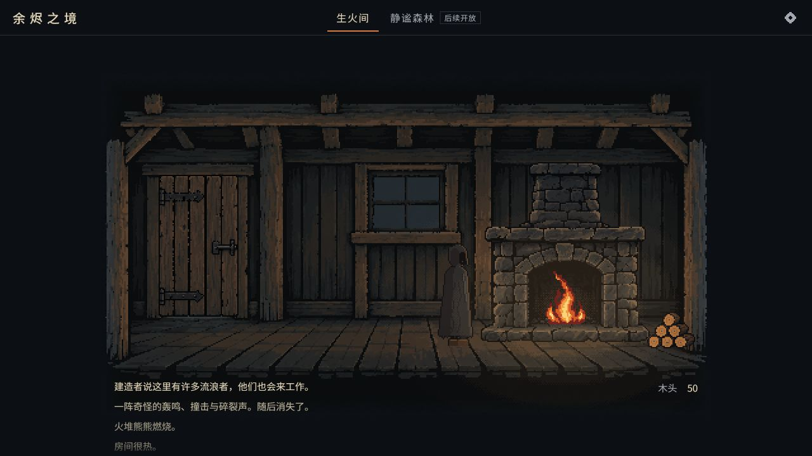
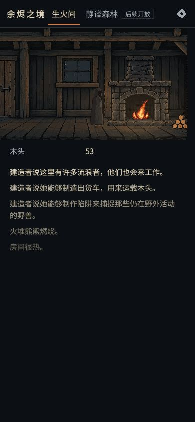

# 炉膛直接交互与开局衔接

2026-10-15，Codex 根据用户授权实现并实际试玩。工程、美术均位于 `adarkroompixel`，本轮没有新增或替换图片。

## 已实现

- 移除常驻的生火／添柴文字按钮与操作条。直接点击炉膛内部及炉沿执行操作，空地不会添柴。
- 初次进入有短暂微光与提示；悬停或键盘聚焦才显示动作、消耗及 F 键。成功、冷却、木头不足在炉边反馈，空闲时收起。冷却用炉下细线表示。
- 炉膛仍是透明的语义按钮，保留 Tab、Enter、F 与屏幕阅读器描述。键盘聚焦有轮廓，鼠标操作不常驻描边；减少动态效果设置可用。
- 点击区域跟随整数缩放和窄屏裁切。390×844 下实际区域为 74×65 CSS 像素，无横向溢出。
- 陌生人恢复且房间暖和后，停留 12 秒自然转入帮忙阶段，每 10 秒提供 2 木头。事件打开时延后衔接；重复触发不会重复注册收入。

## 实际验收

- 使用内置浏览器访问普通入口，从全新开局开始，点击炉膛生火；未刷新、未导入、未用调试面板，等待陌生人到来、恢复、起身帮忙，观察木头持续增加。
- 1280×720 和 390×844 下点击炉膛均有效；点击空地无效。连续点击及随后按 F 共用 10 秒冷却。
- Tab 聚焦炉膛，Enter 添柴成功。设置弹窗打开时按 F 不执行操作；关闭后恢复交互。
- 自然出现的 Penrose 事件可处理并回到房间。
- 补充通过 `?debug` 的可见控件把火和木头清零，点炉膛显示“木头不够生火了”，没有生火。此项是人工设定状态验证。
- 测试后从设置导回体验前备份的存档，回到普通入口。浏览器检查时告警与错误日志为空。
- `npm run check` 通过：TypeScript 检查及 11 个文件、120 项测试；`npm run build` 通过。

新增 `tests/opening.test.ts` 验证无需离开或重载即可恢复、产出幂等，以及房间重新变冷时重置恢复等待。交互和布局通过浏览器实际操作检查。

## 主要文件

`src/ui/hud.ts`、`src/ui/style.css`、`src/ui/strings.ts`：透明点击区域、上下文提示、键盘与反馈；`src/pixel/layout.ts`、`src/pixel/renderer.ts`：逻辑区域和微光；`src/main.ts`：区域布局及开局衔接；`src/app/opening.ts`、`src/core/locations/room.ts`：连续恢复与幂等帮助逻辑。README 与工程说明同步更新。

## 画面

桌面图来自本轮自然连续开局；窄屏图在恢复原进度后补拍，不是同一时刻。

## 后续边界

森林仍为后续开放，站立、行走人物仍是占位素材。本轮未验证真实手机触摸、音频听感、全部事件及长时间性能。前次试玩记录中的人物素材和窄屏场景占比建议仍可继续处理。
