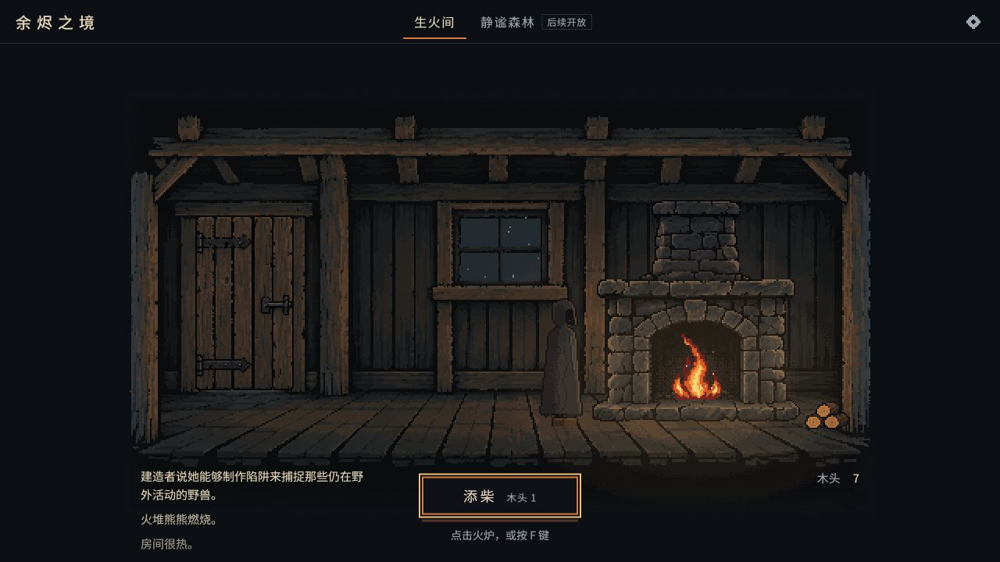
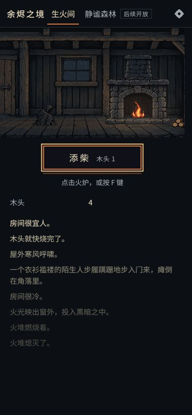

# 黑屋第一轮实际试玩反馈

日期：2026-10-15。体验、美术验收：Codex。工程实现：Claude。

后续更新：用户授权 Codex 打磨交互后，已移除常驻添柴按钮并接通连续恢复，详见 [炉膛直接交互与开局衔接](IMMERSIVE-INTERACTION-2026-10-15.md)。以下保留首次试玩时的观察。

## 判断

像素方向可以继续。冷屋、生火、火焰变化和陌生人出现已经能建立氛围，目前主要不足是后续行动不足、人物姿态素材不完整、窄屏中场景存在感偏弱。这一轮应先把黑屋做成一段有开头、变化和结束的短体验，再扩展地图。

本次仅增加试玩记录和截图，没有修改工程代码或替换美术。

## 实际走过的流程

- 普通入口继续游戏；用 F 添柴；处理自然出现的 Penrose 事件并回到房间。
- 从设置导出试玩存档，重新开始，实际等待首次生火后的陌生人到来；观察温度、人物休息和森林入口的变化。
- 检查 1920×1080、1280×720、390×844 三种浏览器视口。窗口变化后的过渡帧不作为最终布局缺陷。
- 在手机尺寸下点击炉膛，再按 F，观察共用冷却和提示。
- 补充用 `?debug` 回放进门动作、设置木头为零和火力为零，确认缺木头时的拒绝反馈。此项属于调试验证，不等同于普通玩家自然耗尽资源。
- 通过设置导入体验前导出的存档，回到普通入口继续，观察到陌生人站起来并开始提供木头。
- 所查看普通页面的浏览器告警与错误日志为空；这不覆盖音频听感、真实手机触摸、全部事件和长时间性能。

## 下一轮工程任务（Claude）

### 优先级 1：接通陌生人恢复后的下一步

普通黑屋流程中，陌生人恢复后保持休息状态，森林按钮显示“后续开放”。玩家没有离开再回到黑屋的路径，也看不到下一项可做的事。

一个具体的衔接问题：体验前导出的存档中陌生人等级为 3；导入并重新进入后变为 4，出现“她说她可以帮忙”的记录，随后木头从 3 增长到 7。也就是说，继续进展目前可以由重新载入触发，而在普通黑屋连续游玩时没有对应入口。

源码依据：`src/core/locations/room.ts` 的 `updateBuilderState()` 把人物推进到 3 后结束该阶段；`onArrival()` 才把 3 推进到 4 并注册建造者产出。第一阶段的森林入口不可用，正常的离开、返回路径缺失。

建议选择适合黑屋原型的明确推进方式，让玩家在恢复阶段完成后自然看到下一步：例如给一个与陌生人交谈的动作，接通帮助和木头产出，并以一项小任务或明确的阶段结束提示收尾。是否开放最小采木入口由玩法范围决定，先不展开完整森林系统。

验收：全新开始，不刷新、不导入、不使用调试面板，能够从生火走到陌生人恢复、获得后续目标；资源不足时能看见恢复路径或清楚的本阶段终点。

### 优先级 2：提高动作带来的变化感

F、按钮、炉膛点击和冷却提示能工作。反复添柴在火力较高时，玩家获得的新信息较少；主要活动是等待 10 秒后重复操作。

建议把初次生火、陌生人进门、人物恢复三个节点做成更清楚的节奏变化。提示下一目标，避免一直重复强调同一个添柴动作。保留安静的氛围，不必加满闪光、弹窗或数值。

验收：第一次游玩时，不读开发说明也能知道当前动作的作用，以及完成后接下来等待什么或做什么。

### 优先级 3：复核窄屏的视觉重心

390×844 下未观察到横向溢出，文字和主按钮可用，房间画布约为 375×224，仅占视口高度约 27%。人物与火焰细节较小，日志占据大部分后续空间。1280×720 下日志位于画面下缘的有限区域，长句需要较多换行。

建议单独调整竖屏的取景和场景占比，优先保住人物、炉膛、门口三者的关系；日志保留最新关键提示并提供清楚的历史阅读方式。放大场景时需检查人物和炉膛是否被裁掉，不直接拉伸像素。

验收：在手机宽度和桌面侧栏宽度中，能辨认人物姿态、看清火力变化，主按钮和最新目标同时容易找到。

## 下一轮美术任务（Codex）

1. 补同一角色的站立、行走和坐下过渡素材。当前蜷缩图细节较完整，站立、行走使用简单的深色轮廓，姿态切换时风格差异明显。优先补角色，暂缓新地图。
2. 复核柴堆在实际逻辑尺寸下的表现。当前木头截面的橙色与粗轮廓比较显眼，和房间较细的木纹有差异。以运行中的画面为依据决定是否重画。
3. 后续再补真实的开门状态，避免仅用门板横向收窄代替开门。

## 截图

桌面图为导入原试玩存档后，人物已站在炉边的普通页面；手机图为重新开局后人物仍蜷缩时的普通页面，两者不是同一时刻或同一人物阶段。

## 保留与边界

背景、火炉、正式蜷缩人物、火焰和现有配色可继续使用。没有证据要求推翻像素路线或重做全部素材。当前体验结论是：黑屋气氛已成立，但连续游玩的推进和动作反馈仍需打磨。

本轮没有新写自动化测试，也没有将已有的工程测试结果当成视觉验收。截图与反馈来自实际浏览器操作；调试回放和手动设置状态的部分已单独标明。
