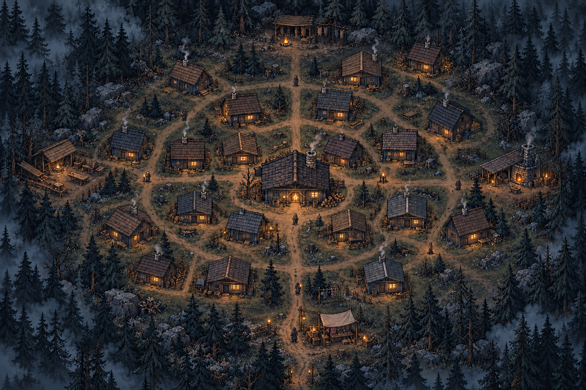

# 俯视聚落 · 整体美术概念

日期：2026-10-16。本目录保留已确认的整体概念与布局研究。后续已生成独立[生产素材](../../../assets/pixel/village/v1/README.md)，并接入[聚落、小屋与人口](../../engineering/phase4-village.md)。下文的概念阶段说明保留，供对照美术方向。

## 方向与范围

- 生火间保持中心位置和最明显的暖光。住宅向外扩展，保留林木、岔路与院落，避免整齐复制房屋。
- 已有生火间内部、近林采集继续使用侧视画面；新增俯视聚落总览。
- 原版居民小屋上限 20、每座容量 4，总容量 80；中心生火间与公共建筑另计。
- 原布局的“4 + 8 + 8”是住宅锚点和扩张顺序的工程提案。概念图用于说明有机聚落的美术方向，不作为精确坐标或分层图使用。
- 前期只考虑桌面体验。用户已明确为节省 token，暂不考虑手机等适配。

## 本轮交付

| 文件 | 用途 |
| --- | --- |
| `village-concept-v2.png` | 当前概念图，1536 × 1024，不透明 PNG |
| `village-concept-v1.png` | 首版保留；人工清点 18 座住宅，修订时补充 2 座 |
| `index.html` | 概念图评审页，可显示 20 座住宅的清点标记 |
| `approved-layout.png` | 此前用户认可的俯视布局草案截图 |
| `layout-study.html` | 可切换 0 / 1 / 4 / 8 / 12 / 20 座的布局示意 |
| `CONCEPT-PROMPT.txt` | 首次生成的完整提示词 |
| `CONCEPT-REVISION-PROMPT.txt` | 补齐两座住宅的完整修订提示词 |
| `manifest.json` | 图片规格、SHA-256、人工清点位置与交付状态 |

生成工具：内置 `image_gen.imagegen`。原始生成文件保留在 Codex 生成目录，项目中的副本经 SHA-256 对照一致。未使用外部 API 或 CLI 生成。

## 视觉检查

- 当前 v2 人工清点：20 座居民小屋、1 座中心主屋；北部猎棚、西部木工作业区、东部加工棚和南部贸易摊位单独计数。评审页的标记仅供核对，不是游戏 UI。
- 北东、南西各补一座住宅，保留原有主屋与四个功能区。
- 主屋、道路和林缘关系清楚；屋顶方向、色差、院落与物件减少复制感。使用可见屋顶与少量墙面的高角度视角，不是严格垂直俯视。
- 保持灰蓝冷雾、灰褐旧木、克制暖窗；四周森林仍是主要边界。
- 未加入地图文字、资源数字、操作按钮或水印。

## 正式素材制作时需要收敛的地方

- 概念图的纹理密度高于现有 480 × 270 运行场景。正式素材要先确认统一的像素密度和建筑尺寸，再减少碎纹理与栅栏细节；不能把大图整体缩小当作最终地图。
- 窗光、烟气、居民和院落物件需独立于建筑与地面，支持空屋、入住、数量变化和减少动态效果。
- 主屋外观在拆分前需进一步对照现有室内门窗、石砌壁炉位置，统一外观与内部结构。
- 住宅清点不等于游戏行为验收。建造、人口、收入、存档和交互仍待后续接入。

## 下一步素材包

1. 无建筑的林地底图、树冠前景与可复用道路／地面零件。
2. 中心生火间外观，以及 3–4 种同等级居民小屋变体。
3. 独立的接地阴影、窗光、烟气与少量院落物件。
4. 居民俯视站立／步行帧；镜头与像素密度与建筑保持一致。

公共建筑先确定空间与剪影，按实际开放的玩法分批制作。概念阶段没有改动运行代码；当前已完成的运行接入及其验证边界见文首工程说明。
