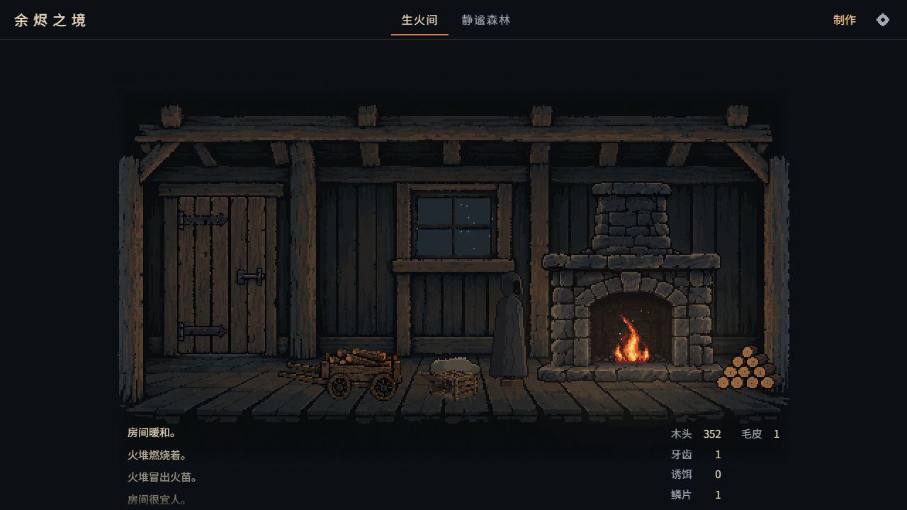
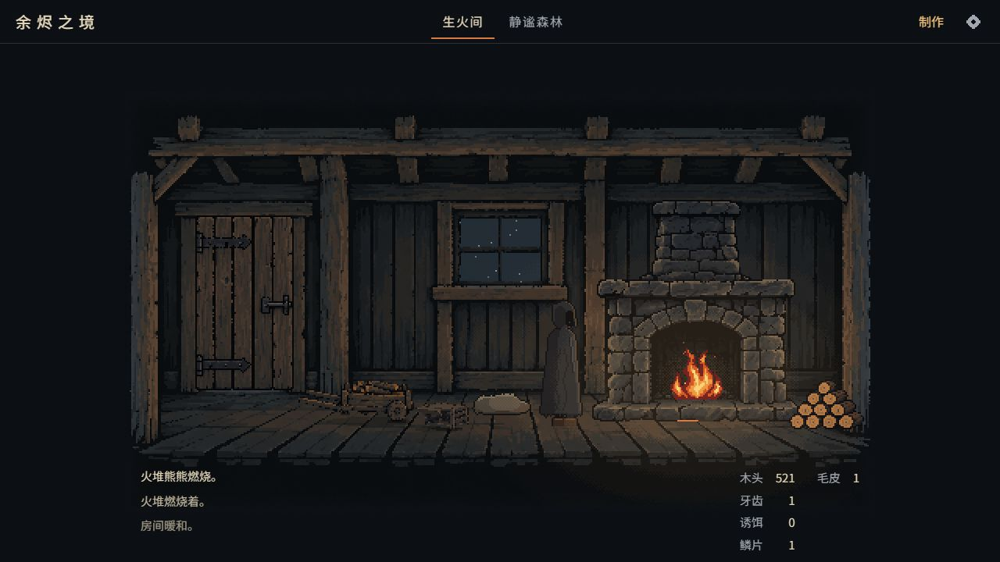

# 手推车与陷阱的场景融合调整

2026-10-15。针对首版物件过于突出、像展示品，且陷阱与毛皮堆相叠的问题，参考原始木屋重绘两件精灵并调整布景。

## 画面与交互

- 推车从 88×38 缩至 74×27，地面锚点从 (160,224) 收到 (148,211)，靠近门旁后排地板。
- 陷阱从 42×22 缩至 34×17，锚点从 (236,224) 移到 (203,216)，与毛皮堆轮廓分开。
- 统一为灰褐色旧木，减少明亮描边和细碎纹理，降低俯视感。轮子与笼底增加像素接触阴影；阴影和精灵一起经过炉火／温度光照合成。
- 空闲时无常驻物件标签。点击各物件仍聚焦对应详情，保留使用、数量和存档行为。
- 手机画面缩小时，将相邻物件的最小 44×44 点击区域排开，避免交叠；区域仍留在画布内，并包含物件可见中心。

## 素材

两次使用内置 `image_gen.imagegen` 分别生成，透明 PNG 原图完整保留。

- [手推车](../../../assets/pixel/workshop/v2/cart.png)、[陷阱](../../../assets/pixel/workshop/v2/trap.png)
- [源图尺寸、alpha、SHA-256 与坐标表](../../../assets/pixel/workshop/v2/README.md)
- [完整提示词](PROMPTS.md)
- v1 素材、提示词与试玩截图另行保留。

## 验证

- `npm run check`：14 个文件、135 项测试通过。包含 PNG 格式、裁取范围、显示比例、逻辑热区，以及 320／390 宽度 × DPR 1／2／3 下最小点击尺寸、物件中心命中、两物件热区分离和画布边界。
- `npm run build`：通过，生产包引用 v2 两张精灵。
- 在独立生产预览（4174）中实际操作两件物品：打开后焦点分别是 `recipe-cart`／`recipe-trap`；Esc 恢复到对应物件。
- 390×844、DPR 3 浏览器模拟中实际点击陷阱、用 Enter 操作推车，均进入正确详情；页面滚动宽度为 390，无横向溢出。
- 手机画布底部 205.33，推车热区底部 201.33、陷阱 205.33；推车右边界 157.66、陷阱左边界 159.66，保留 2 CSS px 间隔。
- 桌面读取建造者及两件物品标签的空闲透明度，均为 0；刷新后物件恢复，场景说明已同步更新为“门旁停着运柴手推车”。
- 已恢复浏览器尺寸与 DPR 设置。手机验收使用浏览器模拟，尚未在实体手机上验收。

## 前后对照

[打开可拖动的对照页](comparison.html)。两张为真实游戏截图，摄像机与画面尺寸相同；炉火动画、飘雪及日志随时间变化。

调整前：

调整后：

