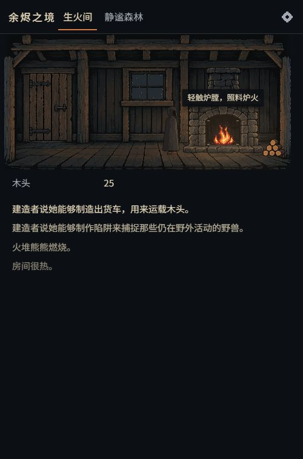

# 序章试玩与下一轮重点

日期：2026-10-15。

后续更新：本报告发现的首批建造入口缺失现已接通，见[手推车与陷阱](phase3-building.md)。以下问题表保留试玩当时的记录。

## 结论

木屋与近林之间的资源循环能正常完成。当前最明显的推进断点是：建造者恢复后，日志已经宣布能制作陷阱、货车，界面却没有相应入口。下一轮应先接通第一项建造与实际收益，再扩展村庄。

本轮先修复首次出门与拾柴引导，保留当前规则数值和素材。

## 实际试玩

使用应用内浏览器，开发入口 `http://127.0.0.1:5174/`。首次进入显示“开始”，没有覆盖已有进度；从生火开始按真实时间推进，没有使用调试快进、改状态或导入存档跳过序章。

完成的操作与观察：

1. 开始后点击炉膛生火，火光出现，炉膛显示冷却。
2. 自然等待陌生人到来、森林解锁，点击木门出发。
3. 拾取枯枝，木头从 4 增至 8；冷却内重复点击没有重复收益。
4. 切换到 390×844 视口，拾取倒木，木头增至 16。
5. 点路标回屋，点炉膛添柴，木头降至 15。
6. 自然等待陌生人休息、恢复并站起，观察到木头继续增长。日志宣布陷阱与货车可制作，但可操作入口仍只有旅行、炉膛和设置。
7. 检查 844×390 横屏，场景仍位于上方，日志在下方，空间利用不足。

建造阶段的截图在代码热更新后，从刚才的试玩存档继续拍摄；开局、采集、恢复本身均在热更新之前实际完成。

## 问题清单

| 优先级 | 发现 | 处理方向 | 本轮状态 |
| --- | --- | --- | --- |
| 最高 | 日志宣布陷阱／货车可制作，却没有入口；玩家完成拾柴后缺少新目标 | 接入建造者交互，先做陷阱 → 检查陷阱 → 毛皮／肉的短链 | 下一轮 |
| 高 | 首次出门与森林提示仅显示 7 秒，读日志即可错过；引导目标也没有自动显示交互标记 | 让提示与场景标记保留到首次成功旅行／采集 | 已修复 |
| 高 | 带木头回屋，仍重复提示“木柴不多了”；每次往返都会重放教学 | 使用已完成的旅行和采集记录控制教学；改为具体操作提示 | 已修复 |
| 中 | 恢复后的站立人物，与原本细致的蜷缩人物风格差距明显 | 补齐同风格站立、休息、行走帧，保持同一人物外观和比例 | 待补素材 |
| 中 | 采集后整块倒木也淡至近乎透明，读起来像整棵树消失 | 保留树干，单独表现可收集的断枝与耗尽状态 | 待调整素材分层 |
| 中 | 手机横屏仍使用上下排列，需要滚动读日志 | 单独设计横屏的场景与信息分栏，维持热区可点 | 后续布局任务 |

### 建造接入前要处理的规则衔接

近林的 `ForestJourney.gather()` 使用固定的 4／8 木头收益，独立于原作 `Outside.gatherWood()`。接入货车前，必须明确货车怎样影响这两处采集；只接按钮会让玩家花木头买到没有近林收益的升级。

第一轮建造建议限制为陷阱及其检查、产物展示，接着再处理货车和第一间小屋。使用已有核心的解锁条件、价格、产物与冷却，避免只展示一个会扣资源的按钮。

## 本轮修复

- 首次森林解锁后，木门提示与交互标记持续显示，直到第一次进入森林。
- 初次进入森林后，枯枝提示与交互标记持续显示；任意一处成功采集都完成教学。
- 事件锁定等原因导致采集失败时，不会提前结束教学。
- 教学完成记录随存档保存；回屋、再次出发和读档不会重复首次教学。旧存档第一次采集后记录完成。
- 出门文案改为“推门去森林，拾些木柴回来”，并更新英文。

改动位于 `src/app/forest.ts`、`src/ui/scene-controls.ts`、`src/ui/strings.ts`。新增一项动作与存档回归测试。

## 验证与边界

- `npm run check`：12 个文件、126 项测试通过，包含新增引导持久化回归。
- `npm run build`：通过。
- 修复后的生产构建使用独立端口 `http://127.0.0.1:4174/` 从新开局复验：自然解锁后出门提示仍在；手机采集两处后回屋没有重放出门教学；添柴可用。再次进入森林并刷新、继续，地点与倒木剩余冷却保留，首次采集教学没有重现。
- 两轮试玩读取到的浏览器警告／错误日志均为 0。390×844 视口实测页面宽度与滚动宽度均为 390，无横向溢出。
- 桌面与手机视口使用浏览器模拟；本轮没有真实手机触摸、音频听感与长时间性能验收。
- 浏览器初次连接遇到本地插件组件路径失效，补齐缺失组件并重连后完成实际试玩。

修复后截图：

- [桌面首次出门引导](playtest/2026-10-15/door-guide-desktop.png)
- [手机首次采集引导](playtest/2026-10-15/forest-guide-mobile.png)
- [采集回屋后的手机画面](playtest/2026-10-15/return-room-mobile.png)
