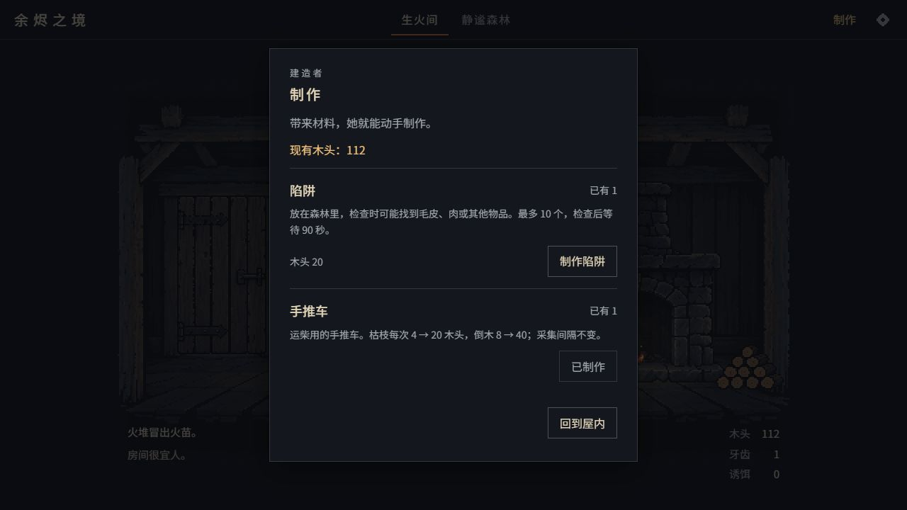

# 建造入口：手推车与陷阱

日期：2026-10-15。

后续视觉更新：人物头顶改为悬停／聚焦提示，屋内手推车、陷阱可查看／出门使用，见[首版素材与场景验收](../art/pixel-workshop-v1/README.md)。随后参考木屋重绘、缩小并调整摆放，补上贴地阴影与手机热区隔离，见[场景融合调整及前后对照](../art/pixel-workshop-v2/README.md)。最新检查为 135 项测试通过。下方保留首轮建造入口验收记录。

## 可玩的行为

建造者恢复并站到炉边后，点击她身上的“制作”或顶部“制作”按钮，打开制作面板。每项显示作用、当前数量、材料消耗与缺少的材料。材料不足、房间过冷、达到上限时不能制作。

| 项目 | 原版解锁门槛 | 制作消耗 | 上限 | 实际作用 |
| --- | --- | --- | --- | --- |
| 陷阱 | 建造者恢复，首次持有至少 5 木头 | 第 n 个为 10×n 木头 | 10 | 森林出现“检查陷阱”，按原版产物表收获物品 |
| 手推车 | 建造者恢复，持有至少 15 木头 | 30 木头 | 1 | 枯枝 4→20、倒木 8→40 木头，采集间隔仍为 20／45 秒 |

解锁选项不会增加数量，也不会扣资源；成功制作才扣足材料。手推车制作后显示“已有 1／已制作”，不会重复购买。陷阱继续显示下一份的实际造价。

原版手推车把单次拾柴从 10 提高到 50。像素版沿用五倍的运载收益，应用到现有两处采集点；初版未制作时为 4／8，2026-10-16 按试玩反馈下调为 2／4，制作后为 10／20，冷却仍为 20／45 秒。悬停提示、成功反馈、日志和实际入库使用同一份收益计算。数值说明见[近林记录](phase2-forest.md)。

检查陷阱只能在森林进行。每次检查按已有陷阱数量计算掉落，保留原版诱饵逻辑与 90 秒冷却；重复点击不会重复入库。按钮显示数量和剩余冷却，结果同时进入日志、库存与收获提示。手机把操作放在场景下方，桌面放在场景上方的空白处。

## 操作与存档

- 制作面板打开时，炉膛、旅行与场景操作被隔离；F 不会穿透添柴。Tab 在面板内循环，Esc 关闭并把焦点还给入口。
- 事件发生时关闭制作面板，正常聚焦事件选项，不能绕过事件制作或检查陷阱。
- 数量保存在原有 `game.buildings.cart/trap`；检查冷却使用核心 `trapsButton`。刷新、导出／导入后仍保留。
- 这一版只开放手推车和陷阱。通过可选的 `GameOptions.craftables` 限定像素版配方，尚无入口的小屋等不会提前弹解锁提示。无该配置时，核心仍提供完整原版规则；已有建筑存档不会被删除。

## 实现位置

| 文件 | 职责 |
| --- | --- |
| `src/app/building.ts` | 当前支持的配方和制作动作的场景／事件保护 |
| `src/app/forest.ts` | 手推车收益、陷阱检查、冷却读取 |
| `src/ui/hud.ts` | 人物及顶部入口、制作面板、森林陷阱操作、焦点与模态管理 |
| `src/ui/scene-controls.ts` | 使用手推车之后的动态采集收益文案 |
| `src/ui/style.css` | 桌面／手机面板与操作区布局 |
| `src/core/game.ts`、`src/core/locations/room.ts` | 可选配方范围，避免播报尚未实现的配方 |
| `tests/building.test.ts` | 解锁与所有权、材料与上限、动作隔离、两处收益、掉落冷却和存档 |

## 验证

- `npm run check`：13 个文件、132 项测试通过。
- `npm run build`：通过。
- 生产预览 `http://127.0.0.1:4174/` 中，使用上一轮独立试玩存档实际制作了手推车和一份陷阱。手推车变为已有 1；陷阱变为已有 1，下一份材料变为 20 木头。
- 在森林实际采集枯枝，木头 186→206；倒木 206→246。第一次检查陷阱获得牙齿，重复点击没有再获收益；冷却结束后的下一次检查获得鳞片。
- 刷新后恢复森林、采集冷却、陷阱剩余冷却和已有手推车收益。数量与冷却的导出／导入另有自动化测试。
- 用调试面板清零本轮测试存档的木头，看到“制作陷阱”禁用及缺材提示；制作面板内触发测试事件，制作关闭且焦点转到事件“道别”。随后恢复测试材料。这些边界检查使用调试控件；前面的实际制作和森林采集不靠修改状态完成。
- 最终构建检查了 F 隔离、Tab 循环、Esc 焦点恢复；132 项测试覆盖最多十份陷阱和禁止重复制作手推车。
- 1280×720、390×844、320×568 模拟视口验收。手机面板可滚动，320 和 390 宽度均无横向溢出；真实手机触摸与音频听感未验收。
- 本轮读取的浏览器警告／错误日志为 0。

首轮入口交付复用了现有场景与建造者形象；后续已补齐两件物品的场景精灵与点击入口，见文首更新。

## 实际截图

- [手机制作面板](playtest/2026-10-15-building/workshop-mobile.png)
- [手机检查陷阱](playtest/2026-10-15-building/traps-mobile.png)
- [桌面检查陷阱](playtest/2026-10-15-building/traps-desktop.png)
