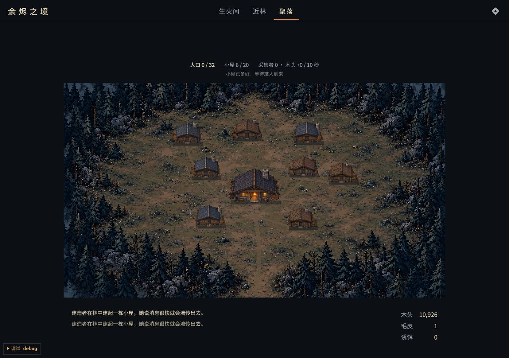
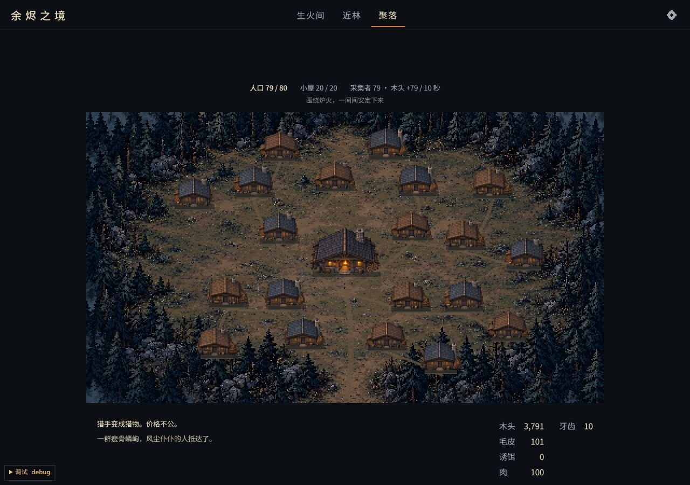
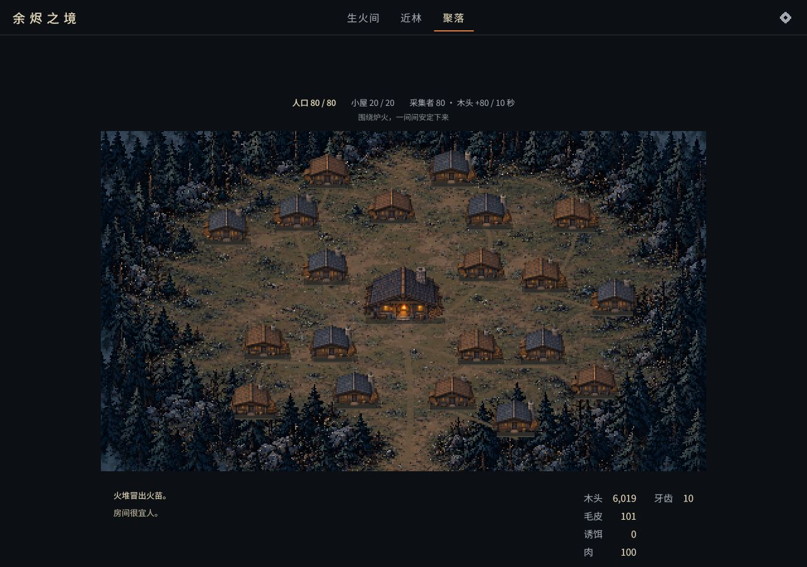
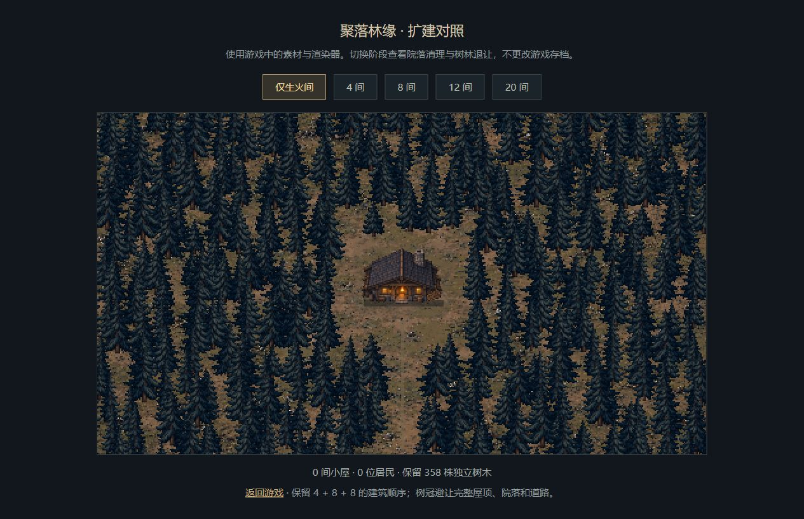
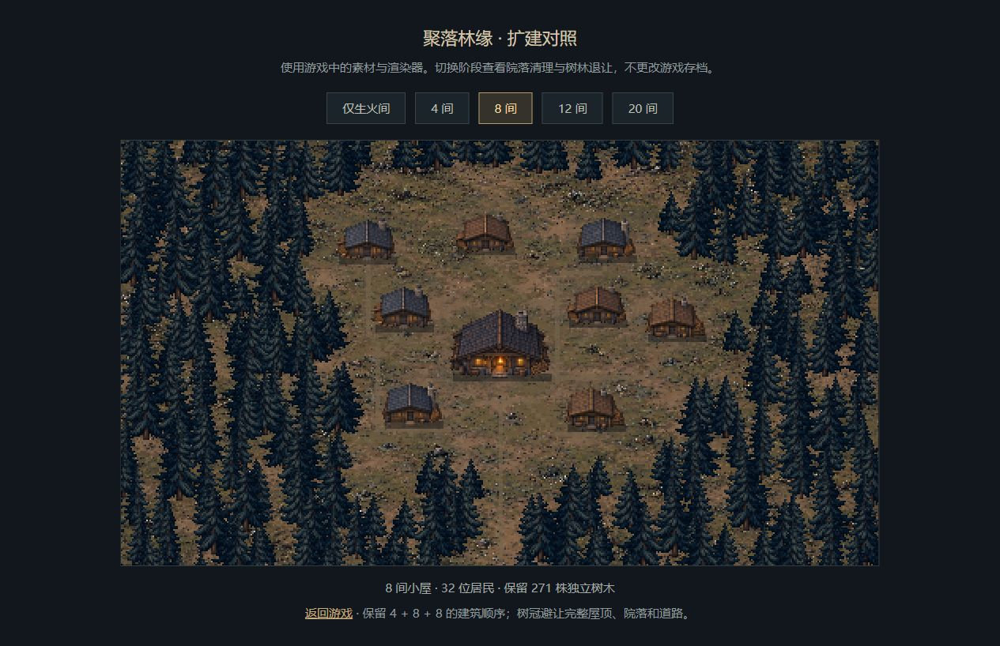
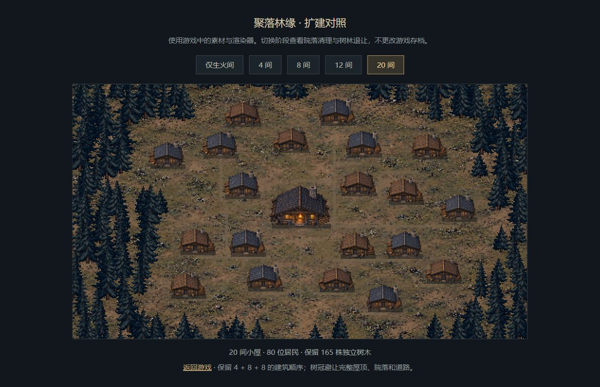
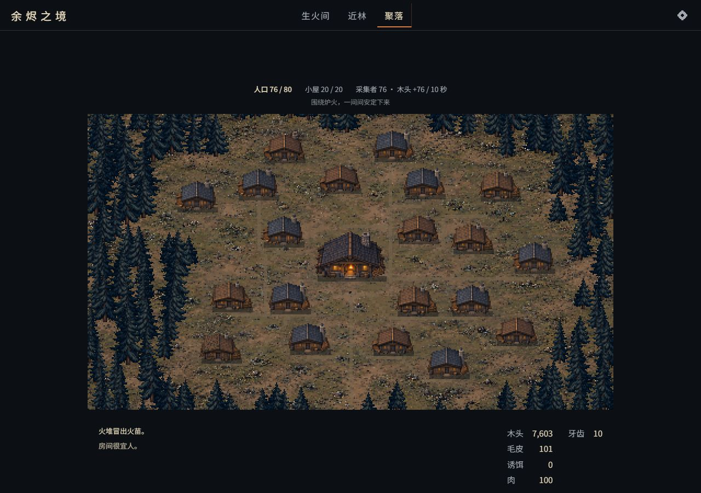
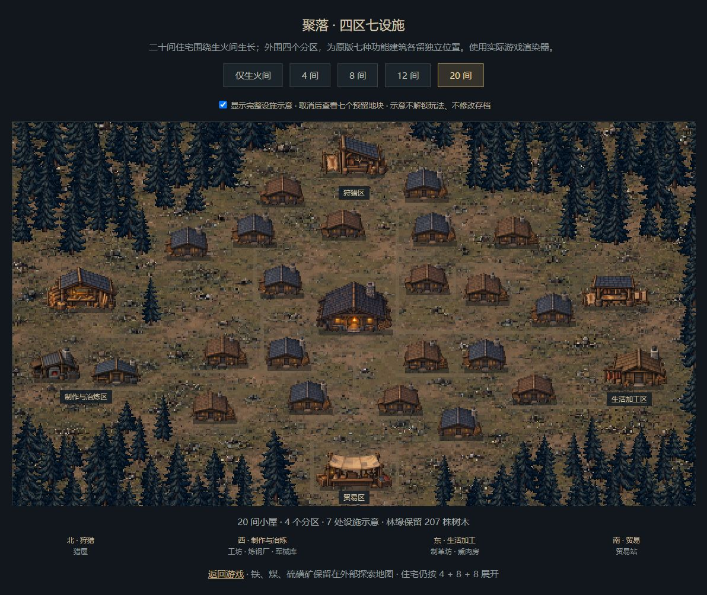
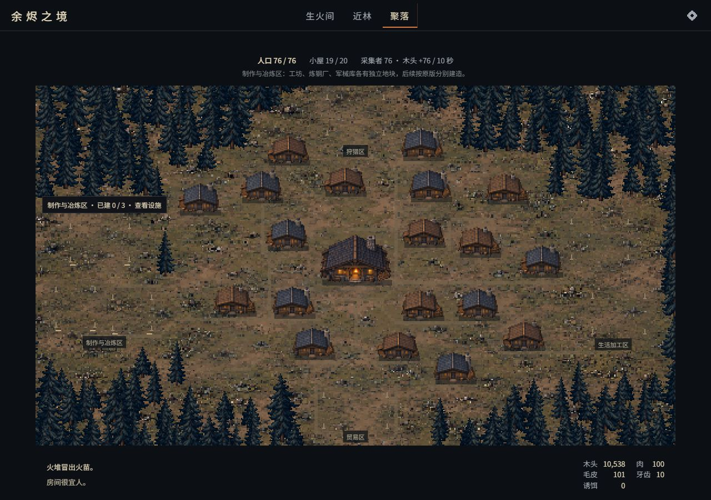

# 聚落总览与居民小屋

日期：2026-10-16。首版可玩实现；使用独立生产素材，不将概念图整体贴进游戏。前期按用户要求只做桌面体验，不增加手机适配。

同日后续已接通公共设施建造、分工、工坊制作及交易，见[生产玩法与事件中文校对](phase5-settlement.md)。下文按首版、林缘修正、四区布局三次验收记录保留，各阶段的范围以当时状态为准。

## 行为

- 建造者恢复、房间温暖且材料足够时，制作面板可建小屋。第一间 100 木头，以后每间多 50，第二十间 1050，总计 11500。上限 20 间，每间容量 4，总容量 80。
- 第一间建成后，顶部解锁“聚落”，配方内也有“看看聚落”。生火间仍为室内侧视，近林仍为侧视采集；聚落使用俯视总览，生火间居中，住宅按固定的 4 + 8 + 8 地块向外扩展。
- 点击中心生火间返回屋内；点击底部道路前往近林；点击小屋显示该地块的住户数。鼠标悬停和键盘聚焦均有贴近建筑的提示。
- 沿用原版人口到来与采集者收入。旅人随时间入住，每名空闲居民每 10 秒采集 1 木头。人口、容量、采集者与对应收入显示在地图上方。屋内及近林期间仍然运转。
- 住宅窗灯按全局人口顺序分配：先住满早建的房子。此为视觉表达，不新增家庭或住房管理规则。空屋窗灯变暗；生火间外观也随炉火熄灭而暗下。
- 原版事件仍有效。事件中不能通过屋顶、导航或制作绕过事件；在聚落不能远程添柴、采集枯枝或检查陷阱。
- 沿用原有建筑与人口字段，新增地点标记 `game.pixel.location = village`。刷新和导入后恢复聚落；旧存档无此字段仍从屋内进入。素材载入失败时返回屋内，避免空白场景。

## 实现与素材

| 文件 | 职责 |
| --- | --- |
| `src/app/building.ts` | 开放小屋配方，沿用建造保护 |
| `src/app/forest.ts` | 三个像素场景与原版两个地点的映射、地点恢复 |
| `src/app/village.ts` | 固定地块、人口与住户数的只读映射 |
| `src/pixel/village.ts` | 地形、道路、住宅、阴影、窗灯与烟点渲染 |
| `src/pixel/village-landscape.ts` | 固定树林、完整树冠避让、逐步清地与道路寻路 |
| `src/ui/village-controls.ts` | 屋顶与道路热区、概览与房屋提示 |
| `src/ui/hud.ts` | 小屋制作、聚落导航、场景说明与交互隔离 |
| `assets/pixel/village/v1/` | 三张生产 PNG、四种小屋图块、裁取清单、原始提示词 |
| `assets/pixel/village/v2/` | 替代地形的无树地面、四株透明树木、裁取清单和原始提示词 |
| `assets/pixel/village/v3/` | 七处公共设施透明图集、裁取清单、原始提示词与生成记录 |

小屋与地面独立；首版为 480 × 270 逻辑画布，同日公共区补充后扩为 576 × 324，住宅宽度 38、生火间宽度 64 不变。为完整地图单独留出上下信息空间。首版素材说明与内置生成工具的提示词见[生产包](../../assets/pixel/village/v1/README.md)。

## 验证

- `npm run check`：16 个文件、142 项测试通过。`npm run build`：通过。
- 自动检查覆盖小屋递增造价、20 间上限、80 人容量、定时入住、屋内自动采木、场景保护、采集冷却、导出导入、旧存档、二十个地块不重叠，以及原始 PNG 的 alpha、裁取、比例与文件散列。
- 1280 × 900 桌面浏览器实际从已有手推车和陷阱的独立测试存档建造第一间小屋，再扩至 4、8、20 间；第二十一间显示“已达上限”并禁用。
- 扩建测试通过可见调试面板补充木头，入住使用调试时间快进。快进中遇到原版“野兽来袭”事件，处理后回到聚落，人口与屋顶提示正常更新；随后人口达到 80 / 80。
- 实际检查聚落到近林的道路、近林枯枝采集及导航返回；聚落没有室内添柴或近林采集热区。刷新后继续仍为 20 间、80 人的聚落。
- 正式构建通过独立预览服务运行，经设置面板导入上述测试存档，继续后恢复 20 间小屋、80 人和聚落地点，确认打包后的 PNG 与场景可用。补材料与快进仅在独立测试存档进行。
- 本轮不覆盖公共建筑、居民步行动画、移动设备或长期平衡测试。

## 同日修正：院落清理与林缘退让

原底图把树木和土地画在一起，外圈建筑即使不彼此重叠，也可能盖住固定树冠。当前替换为 v2 无树地面和独立透明树木；生火间与住宅沿用 v1 图块。生成工具、完整提示词、实际裁取和源文件散列见 [v2 生产包](../../assets/pixel/village/v2/README.md)。v1 地形仅作历史留档，不再进入正式包。

- 树木固定种子与位置，独立于游戏随机数。每间小屋清出覆盖屋顶与四周院落的完整范围，并为道路留出树冠余量；避让使用完整剪影矩形，不能只判断树干落点。树木按地面落点排序，清理后的地形静态缓存，不在每帧重新寻路或安排树林。
- 路网在 3 像素网格上避开全部二十间屋顶，随建造依次露出通往门前的道路；后建的房子不会盖住既有道路，先建的道路也不会随扩建移动。
- `game.pixel.clearedHuts` 保留曾清理的最大地块数。建造成功及继续游戏时记录，旧存档按现有房屋数迁移；房屋损失后空地仍在，导出导入一并保留。此字段只影响视觉，不改变原版材料、人口、事件和收入规则。
- [阶段对照](http://127.0.0.1:5184/docs/art/pixel-village-v2/)直接调用游戏渲染器，支持 0、4、8、12、20 间。示例人口用于点亮窗户；切换不会读写玩家存档。

本次验证：`npm run check` 的 17 个文件、148 项测试全部通过，`npm run build` 通过。新检查覆盖 0–20 每阶段完整树冠与院落、道路不相交，树林逐步减少且剩余树木不移动，道路连续到达所有门前且不穿越现有或未来屋顶，以及空地在房屋损失、旧存档迁移、导出导入后的保留。另校验两份素材包的原始散列、PNG 通道、裁取范围和显示比例。

浏览器中实际从独立测试存档的 19 间补建至 20 间，外圈第 20 间可点击查看住户；原有旅人随后从 76 人增至 78 人，窗灯随入住改变。通过设置面板导出再导入正式构建，继续后恢复 20 间与聚落地点，桌面 1280 × 900 地图、信息栏和外圈屋顶点击正常，浏览器未报告警告或错误。房屋损失后的空地保留由状态与导出导入测试覆盖，本轮未等待自然灾害再次触发。保持仅验收桌面。

## 同日补充：外围四区与原版七设施

直接对照原版 `room.js`、`outside.js`、`world.js` 与飞船发现事件，确认外围四区足够组织村内设施，但不是只有四座建筑：北侧猎屋；西侧工坊、炼钢厂、军械库；东侧制革坊、熏肉房；南侧贸易站。铁、煤、硫磺矿保留在外部地图，飞船有独立地点。完整映射及规则范围见[原版覆盖核对](village-original-coverage.md)。

- 聚落画幅扩为 576 × 324，住宅与生火间尺寸不变，住宅整体平移并微调北侧一间地块。住宅顺序、数量、造价、人口和原存档不变。
- 七处设施使用独立地块和透明美术，每处均保留院落及支路；树林和道路避让包含全部未来屋顶。v3 图集由内置图像工具生成，原图不经重绘，裁取、比例、alpha、散列与完整提示词保存在[v3 生产包](../../assets/pixel/village/v3/README.md)。
- 正式游戏读取七个原版建筑数量，未建时显示预留空地和木桩，已建才显示外观；住宅数量不会免费解锁公共建筑。四区点击可查看设施及后续用途。
- 对照页的完整设施开关只是画面示意，与游戏存档隔离；支持查看 0、4、8、12、20 间及取消设施后的预留地。当前只接入布局、美术与状态展示，公共设施建造、工人分配、购买以及外出界面仍待后续。

验证：`npm run check` 的 17 个文件、154 项测试通过，包含类型检查；`npm run build` 通过。新增原版建筑全集与岗位来源检查、28 处屋顶边界及相互避让、公共区点击范围、七处公共支路连通、0–20 阶段完整树冠避让和全部素材包检查。桌面 1280 × 900 正式构建继续已有测试存档，正确恢复 19 间、76 人及聚落地点，逐一点击四区并显示对应详情，浏览器没有警告或错误。正式存档没有七处公共建筑，已建外观通过共用渲染器的示意页与状态映射测试验收，尚未实际建造七处设施。

