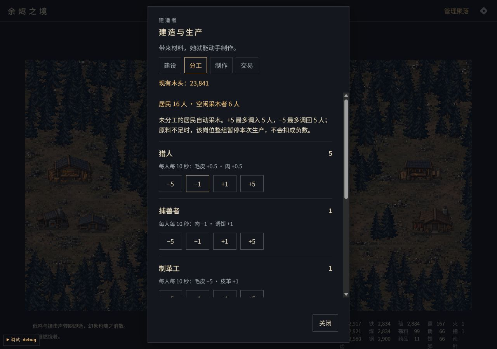
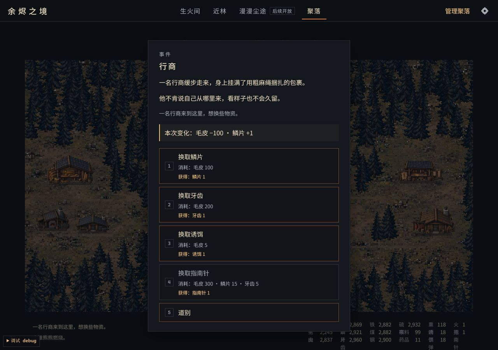
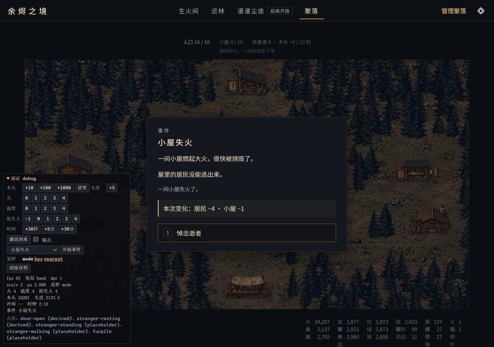

# 公共设施玩法与事件中文校对

2026-10-16。延续四区七设施布局，接通村内生产循环；用户另指出随机事件中文像机翻，本轮直接按原文与实际分支重新校对。仅验收桌面。

## 可玩行为

- 点击外围四区或顶部“管理聚落”，进入建设、分工、制作、交易。分区入口只筛选对应建筑和岗位，“查看全部设施”恢复全村清单；建造者在生火间也可接收建造、制作和购买操作，分工在聚落进行。
- 七种设施仍各建一次：猎屋、工坊、炼钢厂、军械库、制革坊、熏肉房、贸易站。沿用原版材料、解锁、数量上限与房间温度条件，成功后才扣材料和显示外观。只在配方达到原版可见条件后显示，设施不会免费出现。
- 猎屋开放猎人、捕兽者；制革坊、熏肉房、炼钢厂、军械库开放各自岗位。工坊通过制作配方使用，贸易站通过购买使用。已取得矿场的导入存档仍可在全村分工看到对应矿工，不把矿洞建到村内。
- `+1 / +5` 从空闲采木者中调人，`−1 / −5` 调回，最多按实际可用人数变化，不超配或变为负数。每人消耗和产出直接读取原版 `WORKERS`，猎人的 0.5 份产出保留小数。
- 沿用十秒生产周期，未分工居民自动采木。若某岗位整组消耗大于现有材料，本组跳过该轮，不扣料也不产出。界面提示当前缺料，补给后原有计时继续运行；其他岗位照常工作。
- 工坊可制作原版 14 种工具、升级和武器；贸易站可购买指南针及已发现的商品，保留原版购买价格与单件上限。装备、生产和数量沿用原存档字段，刷新、导出和导入恢复。
- 近林不能远程建造、分工、制作或购买；事件期间禁止这些操作。面板支持键盘与 Esc，长清单独立滚动，标题、分类和关闭操作保持可见。

建筑、工人、收入和交易的规则核心未改。界面适配集中在 `src/app/building.ts`、`src/ui/settlement.ts`、`src/ui/hud.ts` 与公共区点击入口。`PIXEL_RECIPES` 开放原版制作配方，仍由核心检查工坊、材料和解锁条件。

## 事件中文

`src/i18n/zh-events.json` 覆盖 `original/script/events/room.js`、`outside.js`、`global.js`、`marketing.js` 全部 18 个事件的 160 条静态原文，并补充五条技能学习提示。`src/i18n/zh-village.json` 统一设施、岗位、材料及装备说明。浏览器和 Node 加载同样的覆盖词典；原版词典与脚本保留原样。

| 原问题 | 处理 |
| --- | --- |
| `The Nomad` 被译为“游牧部落”，正文却是一位来访者 | 改为“行商”，明确以物易物 |
| `price is unfair` 被逐字译作“价格不公” | 按兽袭结果改为村子付出的惨重代价 |
| `evasion` 等技能名含义不清 | 说明闪避、命中率与近战伤害的对应作用 |
| 仓库异响、乞丐回报、流浪者承诺的主语与结果不连贯 | 补清谁来、要什么、做了什么；不保证尚未兑现的承诺 |
| 选项和库存间缺少直接对应 | 选项显示消耗及直接奖励，结果显示实际资源、建筑和居民增减 |

`EventOutcome` 只记录事件初次载入与按钮执行当下的变化，因此读选项期间的采木、生产收入不会混入事件奖励；延迟回报在兑现前不显示为已获得。随机分支与概率不变，不预告随机结果。技能学习的效果通过选项及原版通知显示。原版 `Penrose` 推广彩蛋也在随机池中，本轮补清幻象叙述并标明原作彩蛋，可忽略。当前未全面重写外部地图、遗迹和扩展剧情译文。

## 验证

- `npm run check`：20 个文件、168 项测试通过，含类型检查。`npm run build` 与 `git diff --check` 通过。
- 新增验收覆盖七设施逐项扣料及上限、岗位解锁与人数限制、十秒生产链和缺料整组暂停、制作与贸易条件、指南针上限、地点与事件隔离，以及完整存档恢复。
- 中文检查覆盖全部 160 条原文；英中事件的场景、选项、造价、奖励及概率表一致。事件得失测试包括初始陷阱/人口损失、随机援助回报、重复交易、拒绝缺料选项、延迟回报以及排除被动收入。
- 1280 × 900 的独立正式预览通过设置导入合成存档：5 间住宅、20 人、工具和足够材料，未预建公共设施。逐一建成七设施，分配 5 名猎人及其他五种岗位各 1 人，检查剩余 10 名采木者和持续生产；制作火把、水袋，购买药品与唯一指南针。刷新继续后七设施、十位工人、对应收入与装备仍在。
- 通过可见调试面板触发行商、乞丐和失火。实际交易显示毛皮 −100 / 鳞片 +1；援助显示毛皮 −50 / 牙齿 +20；失火显示居民 −4 / 小屋 −1，随后分工显示 16 名居民、6 名采木者，原十位工人继续存在。未改变这些事件的原版结果规则。
- 最终构建再次核对 Penrose 彩蛋的新说明并选择忽略；把剩余 6 人全部调为猎人，再调回，界面持续更新，未出现运行错误。修复了分工按钮变为禁用时恢复焦点的选择器问题。
- 合成进度、调试触发和自动测试验证接线与规则，不代表从零自然发展的长期经济平衡；不覆盖移动设备、长期性能或声音听感。

## 后续

外部地图、行囊与战斗操作、三矿场探索、飞船修理/升空，以及居民步行动画仍未开放。装备可制作保存，外出用途会随这些界面逐步接入；指南针仍按原版解锁地点，导航明确显示后续开放。本轮沿用现有画面资产，无新增生成素材。
