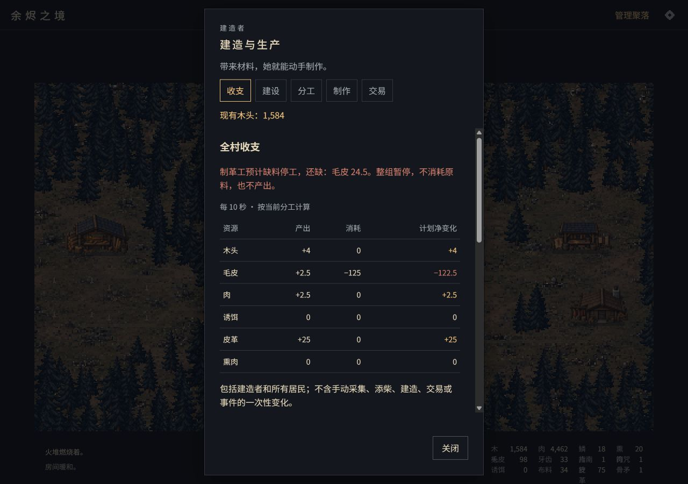

# 前期经营收尾：收支、目标与新档流程

2026-10-16。按用户确认的顺序，先补经营信息与发展引导、检查降低采木收益后的新档流程。仅做桌面，不接入外部探索或战斗，不再改造价、岗位配方、冷却或掉落概率。

## 收支与缺料

“管理聚落”默认打开“收支”；生火间的制作面板也可切换到这一页。无论从哪个公共分区进入，收支都统计全村。

- 按每 10 秒归一化显示产出、消耗、计划净变化，含建造者、采木者、专业岗位和已触发的失窃。保留 0.5 等小数。已发现、目前没有工人生产的相关材料仍可显示零收支。
- 计划净变化表示当前分工的配方收支，不保证原料不足时到账。下轮预测复制库存，在副本上按核心收入源顺序与剩余计时模拟接下来十次收入结算；任一投入不足时整组跳过，列出该岗位的缺材。不会写入库存或改变生产。
- 同一轮先结算的猎人可以供应后结算的制革工，避免仅检查眼前库存就误报停工。预测说明明确排除未来的手动操作、事件和人口变化。
- 收支来源列出各岗位的合计产出与消耗。配工参考读取原版配方：1 名制革工需要约 10 名猎人供毛皮；1 名熏肉工需要约 10 名猎人供肉，若只靠采木者供木，则还需 5 名采木者。建造者额外采木单独计入来源；其他消费者会增加需求，库存可用于短时加工。

实现：`src/app/economy.ts`（只读模型）、`src/ui/economy.ts`（展示）、`src/ui/settlement.ts`（收支分类）。规则核心未修改。

## 阶段建议

场景左上角可展开“下一步”，显示当前建议、目标缺材和建设/制作/交易/分工入口；在事件、演出和其他弹窗期间隐藏。建议沿点火、采木、建造者恢复、手推车、陷阱、住房、狩猎、加工、工坊、装备及指南针推进。人口满且没有采木人手时提示扩住房或调回工人；已从行商取得指南针时不强制建设贸易站。

建议不授予材料、不改配方可见条件、不添加任务奖励，也不锁定其他操作。缺木头、鳞片或牙齿时入口指向近林；缺加工材料且已有猎屋与住房时指向分工，避免把玩家带到尚未显露目标配方的空建设列表。材料够用后才指向建设、制作或购买。推荐储备 10 份熏肉及水袋、背包、骨矛属于较充分的准备建议；原版最低出发条件仍是解锁路径并装入熏肉，不要求这些装备全部完成。像素版远行尚未开放，备齐后明确说明可继续经营，不必建满 20 间小屋或建齐高级设施。读档按当前真实状态重新计算，无额外任务存档。

## 新档节奏验证

`node scripts/playtest-settlement.mjs --export` 从空白状态运行三组种子。每秒推进游戏时钟、每五秒尝试一次合法操作；未导入开局存档、注入材料、改掉落、强制触发事件或跳过恢复与迁入。玩家策略包括保持炉火、实际进出近林采集/检查陷阱、建造住房与设施、逐步调配工人、购买/制作装备，并正常处理随机事件。过程结束后可导出得到的正常存档作浏览器验收。

| 检查点 | 种子 42 | 种子 7 | 种子 99 |
| --- | --- | --- | --- |
| 近林解锁 | 0:45 | 0:45 | 0:45 |
| 建造者恢复 | 2:01 | 2:01 | 2:01 |
| 手推车 | 3:06 | 3:11 | 3:06 |
| 第一间小屋 | 5:11 | 5:11 | 5:06 |
| 猎屋 | 15:31 | 16:16 | 10:11 |
| 指南针 | 62:01 | 37:51 | 30:01 |
| 全部建议物资备齐 | 92:06 | 75:31 | 90:46 |

详细结果保存在 [fresh-progression.json](playtest/2026-10-16-settlement-economy/fresh-progression.json)。三次均为 8 间小屋、32 人，无矿产与高级设施。指南针可能早于工坊取得，种子 99 在行商事件中取得指南针，未将贸易站当成必经门槛。

结论：降低采木后，当前策略在约五分钟获得第一间住房，没有出现硬性资源断路；完整装备准备需要更长时间，后续主要受发展策略、皮革加工及事件影响。这些时间是游戏时钟下的特定策略结果，不是实时人工游玩时长、最快路线或与原版同策略的耗时对照。未据此再次修改经济数值。

## 自动与浏览器验收

- `npm run check`：22 个文件、174 项测试及类型检查通过。新增收支模型与核心十秒实际结算对照、生产顺序、不同周期、整组停工、小数、零岗位收支、目标缺材/推进/已有指南针，以及无预塞材料的新档完整流程。生产构建通过。
- 独立端口 5384 的桌面新档实际完成点火、自然解锁近林、两处采集、回屋恢复、目标跳转和手推车制作，检查建造者收入与目标缺材变化；开发热更新期间重新继续游戏。用户原有 5184 存档未覆盖。
- 正式预览 5284 通过设置导入上述正常流程产出的存档，确认八间住房、三十二居民、已制装备和“前期物资已备齐”建议恢复。
- 实际调整为五名猎人、二十五名制革工，并通过正常交易降低毛皮库存：计划毛皮净变化为 −122.5/10 秒；下轮预测能显示制革组原料不足、皮革本轮预计为零。此操作只用于独立验收进度。测试还验证先生产后加工时不会错误预警。

本轮不包含世界地图、行囊、远行战斗、矿场探索、居民动画或移动设备适配。下一阶段可以接第一次远行循环。
